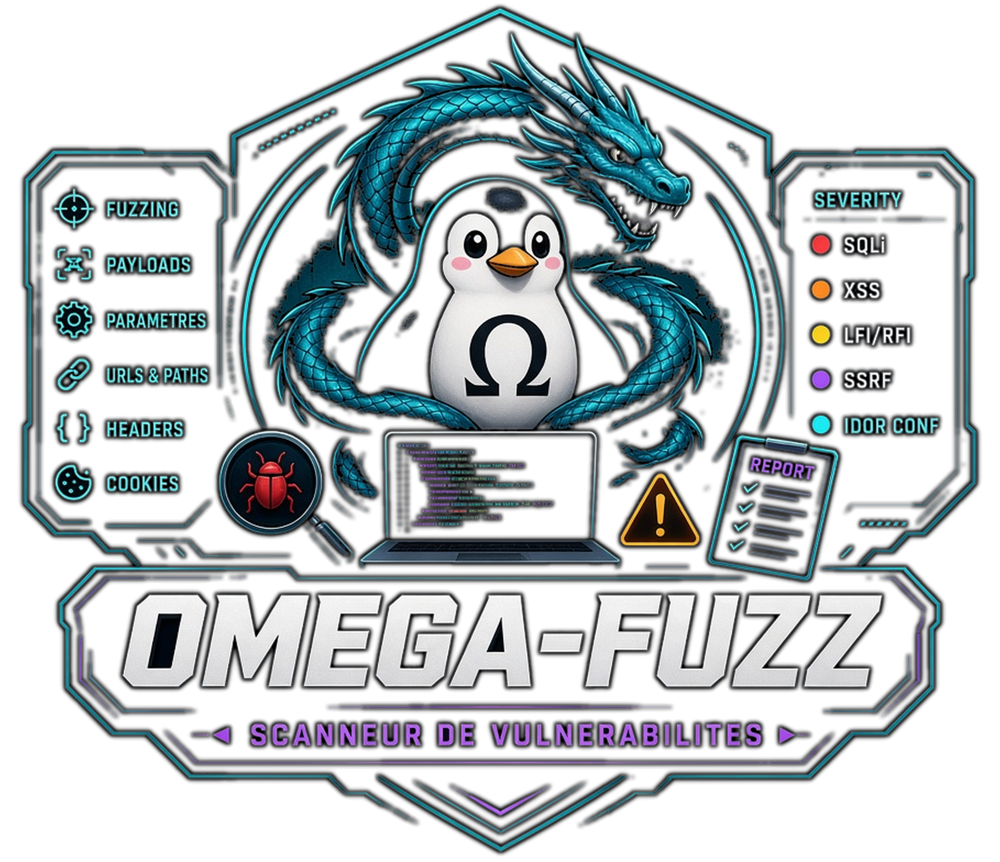

<!-- Copyright (c) 2026 kraynux - kraynux@proton.me - Giấy phép MIT (xem tệp LICENSE) -->
<div align="center">
  
</div>

# 🗱 OMEGA-FUZZ

**Trình quét lỗ hổng**

> Được phát triển bởi [kraynux](https://github.com/kraynux) cho [Omega-Server](https://kraynux.snake-mackarel.ts.net)   

Trang chính thức: [OMEGA-FUZZ](https://kraynux.snake-mackarel.ts.net/omega-fuzz/) &nbsp; Ảnh chụp màn hình: [Screenshots](https://kraynux.snake-mackarel.ts.net/omega-fuzz/screenshots/)  

[](../../../LICENSE)
[](https://www.python.org/)
[](https://www.linux.org/)
[](https://github.com/Textualize/rich)

🌐 Giao diện và báo cáo xuất khẩu có sẵn bằng **17 ngôn ngữ** — xem [Ngôn ngữ giao diện](#ngôn-ngữ-giao-diện).  
**Ngôn ngữ:**  
 [Français](../../../README.md) ·  [English](../en/README.md) ·  [Español](../es/README.md) ·  [Português (Brasil)](../pt-BR/README.md) ·  [Italiano](../it/README.md) ·  [Deutsch](../de/README.md) ·  [Nederlands](../nl/README.md) ·  [Polski](../pl/README.md) ·  [Русский](../ru/README.md) ·  [中文](../zh-CN/README.md) ·  [Tiếng Việt](README.md) ·  [ไทย](../th/README.md) ·  [Bahasa Indonesia](../id/README.md) ·  [日本語](../ja/README.md) ·  [한국어](../ko/README.md) ·  [हिन्दी](../hi/README.md) ·  [العربية](../ar/README.md)

**Omega-Fuzz** là một ứng dụng terminal cục bộ (TUI [Textual](https://github.com/Textualize/textual) + CLI có thể kịch bản hóa) thực hiện khám phá và kiểm thử bảo mật web (fuzzing HTTP) trong các môi trường được ủy quyền: phòng thí nghiệm, bản sao cá nhân hoặc các buổi kiểm thử được đồng ý rõ ràng.

Công cụ thuộc bộ `omega-`, được xây dựng theo Clean Architecture — xem `docs/ARCHITECTURE.md` để biết chi tiết kỹ thuật đầy đủ.

## 1. Tầm nhìn và phạm vi

### Omega-Fuzz làm gì

- Khám phá phạm vi của một mục tiêu duy nhất bằng BFS, bị giới hạn bởi scope rõ ràng (schema, subdomain, đường dẫn được phép/bị chặn, độ sâu), không bao giờ thiếu các biện pháp bảo vệ.
- Fuzzing chung các tham số query string, header HTTP và form `GET` tìm thấy trên mỗi URL được khám phá, rồi kiểm tra ba nhóm chữ ký: XSS phản xạ không phá hủy, injection chung (phát hiện lỗi trong phản hồi), header bảo mật bị thiếu hoặc cấu hình sai — xem [§5](#5-các-kiểm-thử-bảo-mật-được-thực-hiện).
- Chấm điểm mỗi bất thường theo 3 trục (tác động, khả năng khai thác, phạm vi) và suy ra mức độ nghiêm trọng (`low`/`medium`/`high`/`critical`), loại trùng theo `(loại, endpoint, tham số)` và giữ bằng chứng tốt nhất — xem [§6](#6-điểm-và-mức-độ-nghiêm-trọng).
- Hỗ trợ xác thực (cookie, bearer token, form đăng nhập) qua một tệp YAML riêng; thông tin xác thực không bao giờ xuất hiện dưới dạng văn bản rõ trong dòng lệnh.
- Trình bày kết quả trong TUI (Textual) hoặc CLI có thể kịch bản hóa, với ba định dạng xuất (JSON, Markdown, HTML 5 chủ đề).
- Lưu lịch sử quét và findings lâu dài trong SQLite, cùng danh sách mục tiêu yêu thích có thể tái sử dụng.
- Yêu cầu xác nhận rõ ràng (cụm từ chính xác cho các trường hợp nhạy cảm nhất) trước mọi lần quét mạnh, mở rộng hoặc có tắt xác minh TLS.

### Omega-Fuzz không làm gì

- Fuzzing phần thân JSON — mã tồn tại (`plugins/fuzzers/json_body_fuzzer.py`) nhưng chưa được nối (khám phá HTML/BFS không tạo ra schema API JSON hay nguồn mẫu hữu ích).
- Fuzzing form `POST`/`PUT`/`DELETE` — bị loại khỏi pipeline tự động theo lựa chọn thiết kế (nguy cơ ghi dữ liệu ngoài ý muốn lên mục tiêu); chỉ kiểm tra form `GET`.
- Kiểm thử logic nghiệp vụ (IDOR, kiểm soát ủy quyền, phá vỡ workflow) — mã tồn tại (`plugins/logic_tests/`) nhưng nằm ngoài pipeline tự động, chỉ có thể gọi riêng và không bao giờ được kích hoạt bởi quét tiêu chuẩn.
- Quét song song nhiều mục tiêu — một mục tiêu cho mỗi lần quét.
- Chạy lại, so sánh hoặc xuất từ màn hình Lịch sử — chỉ `Scan` và `Finding` được lưu (không lưu cấu hình hiệu lực đầy đủ hay các yêu cầu); chạy lại hoặc xuất lại từ lịch sử sẽ tạo dữ liệu. Màn hình giải thích điều này thay vì âm thầm cung cấp chức năng.
- Kết xuất JavaScript phía máy khách (trang được lấy đúng như máy chủ trả về, không thực thi trong trình duyệt headless).
- Bảng điều khiển web.

## 2. Cài đặt

### Yêu cầu

- Python 3.10+
- Kết nối Internet, để cài phụ thuộc
- Với TUI: cần cài font [Nerd Font](https://www.nerdfonts.com/) trong terminal để hiển thị biểu tượng tiêu đề — nếu không, ký tự sẽ hiển thị thành ô vuông trống (giới hạn giống emoji, nhưng phổ biến hơn nhiều ở người dùng terminal). Thiếu font không ảnh hưởng đến hoạt động, chỉ là vấn đề hiển thị.

### Cài đặt

```bash
[ -d omega-fuzz ] && echo "ℹ️ Đã giải nén ở đây, bỏ qua bước này." || tar -xzf omega-fuzz.tar.gz
cd omega-fuzz/
chmod +x install.sh
./install.sh
```

`install.sh`:

1. Tạo môi trường ảo `.venv` nếu chưa tồn tại.
2. Cài các phụ thuộc (`vendor/omega-lib/` rồi `pip install -e .`; `pyproject.toml` vẫn là nguồn sự thật duy nhất).
3. Cấp quyền thực thi cho `omega-fuzz.sh` và `install.sh`.
4. Thêm alias `fuzz` vào `~/.bashrc` và `~/.zshrc` (không trùng lặp nếu đã có).

### Phụ thuộc

Được khai báo trong `pyproject.toml` (không có `requirements.txt`):

- `omega-lib`: thư viện chung của bộ công cụ (chủ đề xuất, phát hiện terminal, `ConfidenceLevel`) — được đóng gói trong `vendor/omega-lib/`
- `httpx`: yêu cầu HTTP không đồng bộ (khám phá + fuzzing), stream phản hồi (không bao giờ giữ toàn bộ phản hồi trong bộ nhớ, kể cả với tệp nhiều GB do mục tiêu phục vụ)
- `beautifulsoup4` + `lxml`: trích xuất URL và form HTML
- `jinja2`: mẫu cho xuất HTML
- `textual`: giao diện TUI, chủ đề, tự động thích ứng terminal
- `pyyaml`: nạp tệp `--auth-config`
- Phụ thuộc phát triển (`pip install -e ".[dev]"`): `pytest`, `pytest-asyncio`, `pytest-cov`, `pytest-httpserver`, `ruff`, `mypy`, `import-linter`

## 3. Sử dụng

### Chế độ tương tác (TUI)

Được khuyến nghị cho sử dụng hằng ngày — chạy không có đối số:

```bash
./omega-fuzz.sh
```

nếu đã tạo alias, chỉ cần gõ `fuzz` trong terminal:

```bash
fuzz
```

Luồng sử dụng: màn hình khởi động (đóng bằng phím hoặc click) → menu chính (Quét / Mục tiêu / Thiết lập / Lịch sử / Trợ giúp) → nhập mục tiêu (URL đầy đủ, bắt buộc schema `http://`/`https://`), preset hoặc cấu hình thủ công (scope + mức độ mạnh), xác thực tùy chọn, xác minh TLS, ghi đè giới hạn → màn hình xem lại (xác nhận đơn giản, hoặc cụm từ chính xác `OUI-J-AI-L-AUTORISATION` cho trường hợp nhạy cảm) → quét (chỉ báo không xác định, nút **Dừng** luôn khả dụng) → kết quả (findings, xuất) → lịch sử (chi tiết một lần quét trước và findings liên quan) cùng mục tiêu yêu thích từ menu chính. Việc thích ứng terminal (màu sắc, kích thước, suy giảm cấu trúc) diễn ra tự động.

#### Phím tắt

| Phím | Hành động |
|---|---|
| `↑` / `↓` | Điều hướng giữa các phần tử màn hình |
| `Tab` / `Shift+Tab` | Điều hướng giữa các trường form |
| `Esc` | Quay lại màn hình trước (xác nhận thoát ở màn hình khởi động) |
| `t` | Chủ đề tiếp theo (áp dụng ngay, không cần xác nhận) |
| `r` | Làm mới việc phát hiện terminal |
| `a` | Hiện trợ giúp (bảng các preset đi kèm) |
| `q` | Thoát (có xác nhận) |
| `Ctrl+P` | Bảng lệnh (Theme, Thoát, Chụp màn hình) |

### Ngôn ngữ giao diện

Giao diện có sẵn bằng 17 ngôn ngữ: tiếng Pháp, tiếng Anh, tiếng Tây Ban Nha, tiếng Bồ Đào Nha (Brazil), tiếng Ý, tiếng Đức, tiếng Hà Lan, tiếng Ba Lan, tiếng Nga, tiếng Trung giản thể, tiếng Việt, tiếng Thái, tiếng Indonesia, tiếng Nhật, tiếng Hàn, tiếng Hindi và tiếng Ả Rập. Ngôn ngữ được chọn trong Thiết lập («Ngôn ngữ / Language») và áp dụng sau khi khởi động lại giao diện; biến `OMEGA_FUZZ_LANG` (ví dụ `OMEGA_FUZZ_LANG=en ./omega-fuzz.sh`) ép ngôn ngữ cho một phiên. Khi chạy từ omega-suite, omega-fuzz dùng ngôn ngữ của bộ công cụ. Trên console văn bản Linux (TTY), tiếng Việt và các ngôn ngữ không dùng chữ Latinh được hiển thị bằng tiếng Anh trong suốt phiên đó. Dòng lệnh vẫn bằng tiếng Pháp.

### Chế độ kịch bản (CLI)

```bash
# Quét với preset sẵn dùng
./omega-fuzz.sh scan --target https://example.com --preset prod-safe

# Kết hợp thủ công scope + mức độ mạnh (không dùng preset)
./omega-fuzz.sh scan --target https://example.com --scope-profile standard --aggressiveness standard

# Với xác thực (tệp YAML, không bao giờ có thông tin xác thực rõ trong dòng lệnh)
./omega-fuzz.sh scan --target https://example.com --preset staging-full --auth-config auth.yaml

# Dry-run: cấu hình hiệu lực và kế hoạch ước tính, không gửi yêu cầu nào
./omega-fuzz.sh scan --target https://example.com --preset prod-safe --dry-run

# Xuất có đích (thư mục, định dạng, chủ đề HTML)
./omega-fuzz.sh scan --target https://example.com --preset prod-safe \
    --output-dir ./rapports --format html --export-theme omega-neon
```

Các tùy chọn của `scan`:

| Tùy chọn | Mặc định | Tác dụng |
|---|---|---|
| `--target` | *(bắt buộc)* | URL mục tiêu, bắt buộc schema `http://`/`https://` (không bao giờ tự điền) |
| `--preset` | — | Preset sẵn dùng (xem [§4](#4-hồ-sơ-phạm-vi-và-preset)) |
| `--scope-profile` | — | Hồ sơ phạm vi, kết hợp với `--aggressiveness`, không dùng `--preset` |
| `--aggressiveness` | — | Mức độ mạnh, kết hợp với `--scope-profile`, không dùng `--preset` |
| `--auth-config` | — | Tệp YAML xác thực |
| `--insecure-tls` | tắt | Tắt xác minh TLS (kích hoạt xác nhận tăng cường) |
| `--max-duration` | *(theo hồ sơ)* | Ghi đè thời lượng tối đa (giây) |
| `--max-requests` | *(theo hồ sơ)* | Ghi đè số yêu cầu tối đa |
| `--max-tests` | *(theo hồ sơ)* | Ghi đè số kiểm thử tối đa |
| `--max-concurrent` | *(theo hồ sơ)* | Ghi đè mức đồng thời tối đa |
| `--dry-run` | tắt | Hiện cấu hình hiệu lực và kế hoạch ước tính, không gửi yêu cầu |
| `--output-dir` | `var/exports/` | Thư mục báo cáo xuất, tên `<preset>-<dấu thời gian>.<phần mở rộng>` (có thể ghi đè trong Thiết lập) |
| `--format` | `all` | `json`, `markdown`, `html` hoặc `all` |
| `--export-theme` | `omega-base` | Chủ đề báo cáo HTML xuất (không ảnh hưởng json/markdown) |

Không có lệnh con `history`/`show` trong CLI: lịch sử và mục tiêu yêu thích chỉ xem được trong TUI.

Nếu alias đã được tạo bởi `install.sh`, `fuzz scan ...` hoạt động từ bất kỳ đâu trong terminal, không cần tiền tố `./omega-fuzz.sh`.

## 4. Hồ sơ phạm vi và preset

### Hồ sơ phạm vi

| Hồ sơ | Chế độ | Độ sâu tối đa | Hạn chế |
|---|---|---|---|
| `strict` | mục tiêu chính xác | 1 | Chặn `/health`, `/ready`, `/metrics`, `/favicon.ico`, `/robots.txt` |
| `standard` | + subdomain | 2 | Chặn subdomain tĩnh thông thường, đường dẫn kỹ thuật và tài nguyên (hình/css/js/font) |
| `large` | + subdomain | 4 | Chỉ chặn đường dẫn kỹ thuật và tài nguyên (bao gồm lưu trữ/PDF) |
| `api` | mục tiêu chính xác | 3 | Giới hạn `/api`, `/v1`, `/v2`; chặn tài liệu và tài nguyên |
| `custom` | + subdomain | 3 | Không hạn chế mặc định — điểm khởi đầu cho cấu hình thủ công |

Bất kể hồ sơ được chọn, danh sách phần mở rộng nhị phân/tệp lớn (`.iso`, `.zip`, `.exe`, `.mp4`...) luôn bị loại khỏi crawl và fuzzing, kể cả trong `custom` — liên kết đến tệp loại này không bao giờ được lấy bằng yêu cầu HTTP thực, để tránh thư mục tải xuống làm chậm quét trong nhiều phút.

### Mức độ mạnh

`doux` · `standard` · `agressif` · `violent` — mỗi mức có giới hạn cơ sở riêng (thời lượng, yêu cầu, kiểm thử, độ sâu, đồng thời), bị preset ghi đè nếu có.

### Preset sẵn dùng

| Preset | Phạm vi | Mức độ mạnh | Thời lượng tối đa | Yêu cầu tối đa | Kiểm thử tối đa | Độ sâu tối đa | Xác nhận tăng cường |
|---|---|---|---|---|---|---|---|
| `prod-safe` | strict | doux | 300 giây | 1.000 | 500 | 1 | không |
| `staging-full` | standard | standard | 1.800 giây | 20.000 | 10.000 | 2 | không |
| `lab-deep` | large | agressif | 3.600 giây | 100.000 | 50.000 | 4 | không |
| `lab-extreme` | large | violent | 7.200 giây | 500.000 | 250.000 | 5 | **có** |
| `api-hardened` | api | agressif | 1.800 giây | 50.000 | 25.000 | 3 | không |

Quét bị chặn cho đến khi được xác nhận. Xác nhận **tăng cường** (nhập chính xác cụm từ `OUI-J-AI-L-AUTORISATION`) được yêu cầu khi có ít nhất một trong ba yếu tố: mức độ mạnh `violent`, preset `lab-extreme`, hoặc tắt xác minh TLS (`--insecure-tls`) — với tổ hợp bất thường không có một trong ba yếu tố này, chỉ cần xác nhận đơn giản có/không.

## 5. Các kiểm thử bảo mật được thực hiện

Pipeline tự động, trên mỗi URL được khám phá trong phạm vi (và mỗi form `GET` tìm thấy ở đó):

| Kiểm thử | Kích hoạt | Nội dung kiểm tra |
|---|---|---|
| Fuzzing tham số chung | mọi tham số query string | Hành vi của mục tiêu với giá trị biên/lệch |
| Fuzzing header | một lần mỗi URL, 4 header cố định (`User-Agent`, `Referer`, `X-Forwarded-For`, `Accept-Language`) | Hành vi của mục tiêu với giá trị biên/lệch trong header |
| Fuzzing form (chỉ `GET`) | mọi trường form `GET` được khám phá trong phạm vi | Hành vi của mục tiêu với giá trị biên/lệch trong trường form |
| XSS phản xạ | mọi tham số query string | Phản xạ payload không được lọc trong phản hồi (không phá hủy) |
| Injection chung | mọi tham số query string | Phát hiện lỗi máy chủ trong phản hồi với payload injection (không fingerprint SQL/NoSQL cụ thể) |
| Header bảo mật | một lần mỗi URL | Header bảo mật bị thiếu hoặc cấu hình sai trong phản hồi |

Ba kiểm thử đầu (fuzzing tham số/header/form chung) là một công cụ biến đổi **không phát hiện** — chúng không bao giờ tạo `Finding` trực tiếp; chỉ các lỗi máy chủ (5xx) gặp phải được đếm trên `Test` tương ứng. Chỉ các chữ ký (XSS, injection, header bảo mật) tạo findings.

## 6. Điểm và mức độ nghiêm trọng

Mỗi bất thường được phát hiện được chấm theo 3 trục (`impact`, `exploitability`, `scope`, mỗi trục 1–5) tùy theo bản chất quan sát — ánh xạ cố tình **bảo thủ** (phần thấp của thang, không có xác nhận con người ở bước tự động này):

| Điểm thô (tổng 3 trục) | Mức độ nghiêm trọng |
|---|---|
| ≥ 13 | `critical` |
| ≥ 10 | `high` |
| ≥ 7 | `medium` |
| < 7 | `low` |

Điều chỉnh thủ công (`severity_override`) vẫn khả dụng nhưng luôn yêu cầu lý do rõ ràng. Các findings tương đương (cùng loại, cùng endpoint, cùng tham số) được loại trùng, giữ bằng chứng tốt nhất có sẵn (mức độ tin cậy `omega_lib.core.confidence.ConfidenceLevel`, rồi điểm thô nếu bằng nhau).

## 7. Xác thực

Tệp YAML riêng (`--auth-config`), không bao giờ có thông tin xác thực rõ trong dòng lệnh:

| Chế độ | Tác dụng |
|---|---|
| `none` | Không xác thực (mặc định) |
| `cookie` | Cookie phiên được cung cấp trực tiếp |
| `bearer_token` | Token `Authorization: Bearer ...` |
| `login_form` | Xác thực qua form (URL đăng nhập, trường người dùng/mật khẩu) |

## 8. Kiến trúc

Omega-Fuzz được tổ chức theo **Clean Architecture** (domain / application / infrastructure / interfaces / ports / core / app / plugins), phù hợp với khuôn mẫu bộ `omega-` (xem `omega-check`/`omega-deep`/`omega-fold`) và được `import-linter` kiểm tra ở mỗi thay đổi. Chi tiết đầy đủ nằm trong **`docs/ARCHITECTURE.md`**.

Tổng quan rất ngắn:

```text
src/omega_fuzz/
├── domain/          Logic nghiệp vụ thuần (mục tiêu/phạm vi, yêu cầu, kiểm thử, findings, hồ sơ, báo cáo...)
├── application/     Trường hợp sử dụng (commands/queries) và bộ điều phối (khám phá, quét, báo cáo, giới hạn)
├── ports/           Hợp đồng mà ứng dụng mong đợi (http_client, repositories, exporters...)
├── infrastructure/  Triển khai cụ thể (httpx, BeautifulSoup, SQLite, exporter Jinja2 — Textual KHÔNG ở đây)
├── interfaces/      tui/ (Textual) và cli/ (kịch bản hóa), tương đương chức năng nghiêm ngặt
├── plugins/         Fuzzer và chữ ký (hàm thuần, không bao giờ truy cập mạng trực tiếp)
├── app/             Lắp ráp (Container, composition root, vòng đời)
└── core/            Từ vựng chung, lỗi, hằng số
```

Nguyên tắc thiết kế:

- `plugins/fuzzers/` và `plugins/signatures/`: hàm thuần xây dựng kế hoạch kiểm thử (`Test` + `ScanRequest`), không bao giờ dùng `HttpClient`.
- `infrastructure/network/`: thực hiện mạng (`httpx`, stream giới hạn bộ nhớ), không bao giờ đánh giá.
- `infrastructure/analyzers/`: đọc phản hồi đã nhận, tạo `Observation` có cấu trúc, không bao giờ tính lại điểm.
- `interfaces/`: chỉ hiển thị, không chứa logic nghiệp vụ.

## 9. Xuất

Báo cáo Markdown và HTML được ghi bằng ngôn ngữ chọn trong Thiết lập («Ngôn ngữ bản xuất», mặc định là ngôn ngữ giao diện); JSON vẫn là dữ liệu, không được dịch. Báo cáo được tạo mặc định trong `var/exports/` (đường dẫn runtime neo vào thư mục dự án, `$OMEGA_FUZZ_VAR_DIR` để ghi đè, cũng có thể ghi đè trong màn Thiết lập), hoặc theo đường dẫn chỉ định (`--output-dir`). Tên tệp phẳng, không có thư mục con: `<preset>-<dấu thời gian>.<phần mở rộng>` (ví dụ `prod-safe-2026-09-01_14-30-22.html`).

### JSON, nguồn sự thật

Cấu trúc báo cáo đầy đủ (cấu hình hiệu lực, thống kê, kiểm thử, findings), có thể tuần tự hóa JSON nghiêm ngặt.

### Markdown, báo cáo ngắn gọn cho người

Đọc được ngoài terminal, không có mã ANSI.

### HTML, báo cáo web độc lập

5 chủ đề để chọn (`--export-theme` trong CLI, bộ chọn trong TUI): `omega-base`, `omega-burn`, `omega-neon`, `light-basic`, `light-alt`.

## 10. Lịch sử và mục tiêu yêu thích

Mỗi lần quét được lưu (SQLite, `var/db/omega-fuzz.db`) cùng findings, xem được từ màn hình Lịch sử trong TUI. Chỉ `Scan` và `Finding` được lưu — không lưu cấu hình hiệu lực đầy đủ hay các yêu cầu chi tiết — nên không có chạy lại, so sánh hay xuất mới từ màn hình này (màn hình giải thích điều đó thay vì tạo dữ liệu).

Màn hình **Mục tiêu** giữ danh sách yêu thích (URL chuẩn hóa, `var/targets.json`), tái sử dụng để điền trực tiếp trường Mục tiêu của lần quét mới.

## 11. Ảnh chụp màn hình

Lệnh **Chụp màn hình** trong bảng lệnh (`Ctrl+P`): lưu SVG màn hình TUI hiện tại mặc định vào `var/screenshots/`, có thể ghi đè trong màn Thiết lập (như thư mục xuất). Có chức năng dọn dẹp riêng trong Thiết lập.

## 12. Tương thích terminal

TUI (Textual) tự động phát hiện khả năng terminal (trình mô phỏng, kích thước) và điều chỉnh stylesheet cấu trúc tương ứng (`complete`/`standard`/`reduced`/`mono`), không cần cờ thủ công. CLI luôn ở dạng văn bản thuần, độc lập với terminal. Chính sách dùng chung cho toàn bộ bộ `omega-` (`omega-lib`, `terminal/policies.py`).

### Hồ sơ theo trình mô phỏng phát hiện

| Trình mô phỏng | Hồ sơ ban đầu |
|---|---|
| Ghostty, Alacritty, WezTerm, Kitty | `complete` |
| Konsole, GNOME Terminal, Terminator, Xfce4 Terminal | `standard` |
| xterm, urxvt, SSH hiện đại | `reduced` |
| TTY Linux, SSH cũ | `mono` |
| Trình mô phỏng không nhận diện | `reduced` (fallback mặc định) |

### Hồ sơ theo kích thước terminal

| Kích thước tối thiểu (cột × dòng) | Giới hạn hồ sơ |
|---|---|
| 120 × 32 | `complete` |
| 100 × 28 | `standard` |
| 80 × 24 | `reduced` |
| thấp hơn | `mono` |

Hồ sơ cuối cùng là **hồ sơ hạn chế hơn trong hai** (trình mô phỏng và kích thước) — có thể làm mới trực tiếp bằng phím `r`.

## 13. Kiểm thử

```bash
source .venv/bin/activate
lint-imports        # xác minh Dependency Rule (6 hợp đồng)
pytest -q           # 344 kiểm thử
ruff check src tests
mypy -p omega_fuzz
```

Cấu trúc: `tests/unit/` (domain và application, không I/O thực), `tests/integration/` (hệ thống tệp thật qua `tmp_path`, máy chủ HTTP giả `pytest-httpserver`, cơ sở dữ liệu SQLite thật, CLI end-to-end), `tests/tui/` (điều hướng qua `Pilot`, kiểm tra cấu trúc — không tự nhận kiểm tra trực quan tự động).

## 14. Ngoài phạm vi

- Fuzzing phần thân JSON (mã có, chưa nối — không khám phá schema API)
- Fuzzing form `POST`/`PUT`/`DELETE` (loại theo lựa chọn, nguy cơ ghi)
- Kiểm thử logic nghiệp vụ (IDOR, ủy quyền, workflow) ngoài gọi thủ công
- Quét song song nhiều mục tiêu
- Chạy lại, so sánh hoặc xuất từ lịch sử
- Kết xuất JavaScript phía máy khách
- Bảng điều khiển web

---

> Omega-Fuzz — Khám phá phạm vi, kiểm thử với các biện pháp bảo vệ rõ ràng, không bao giờ đoán điều chưa được xác nhận.
